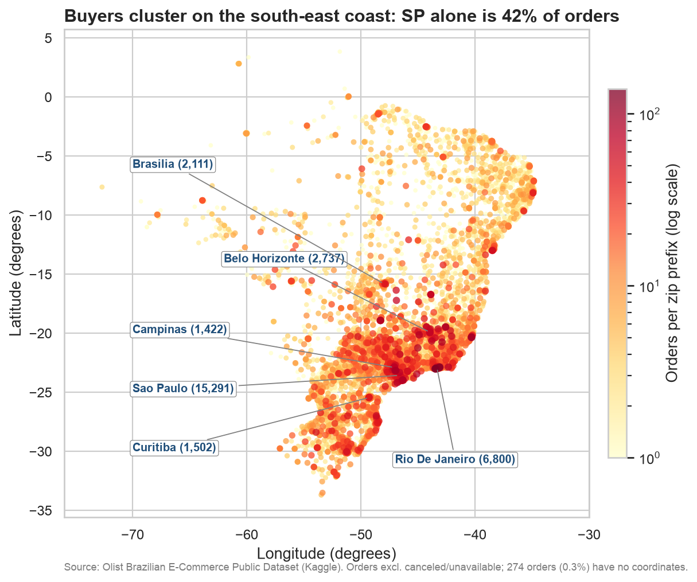
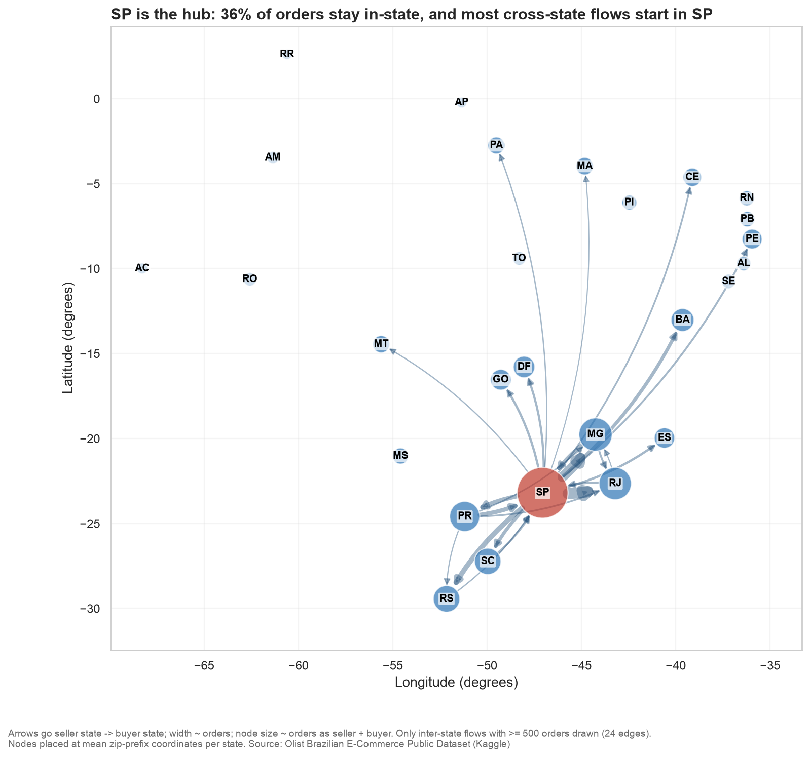
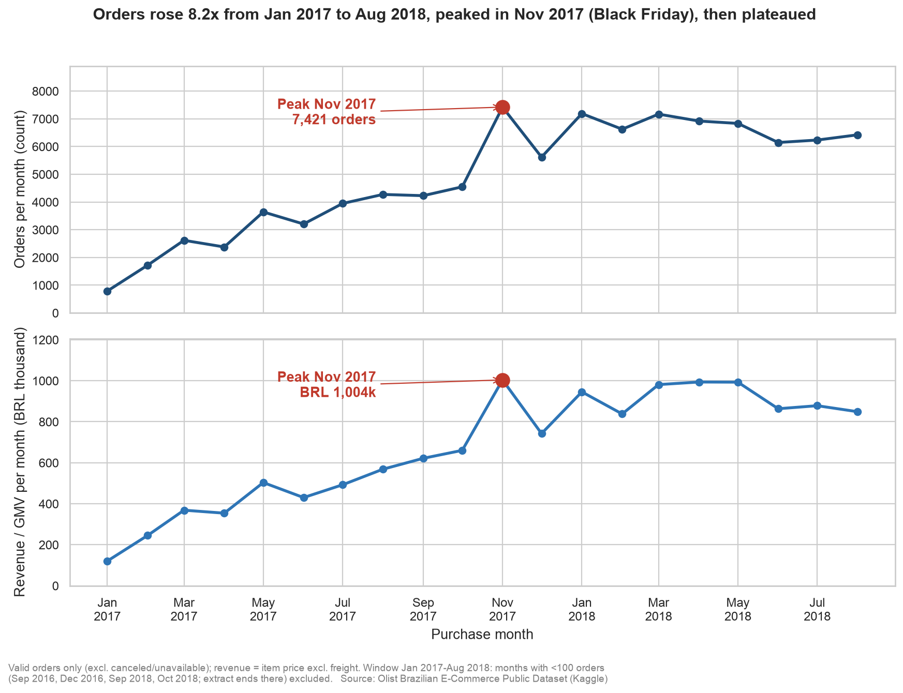
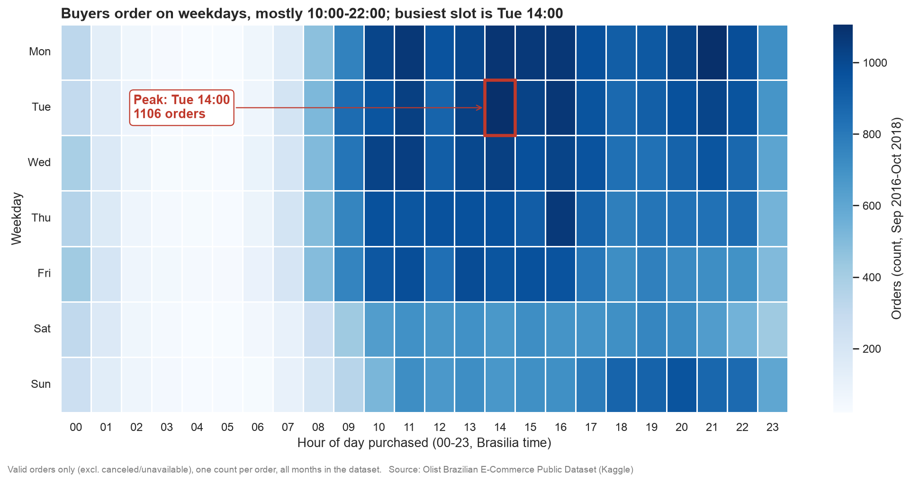
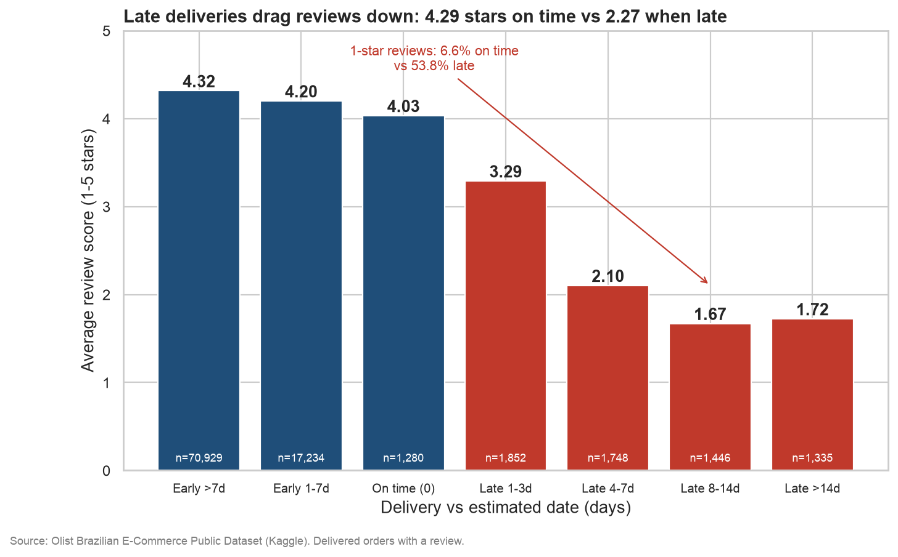
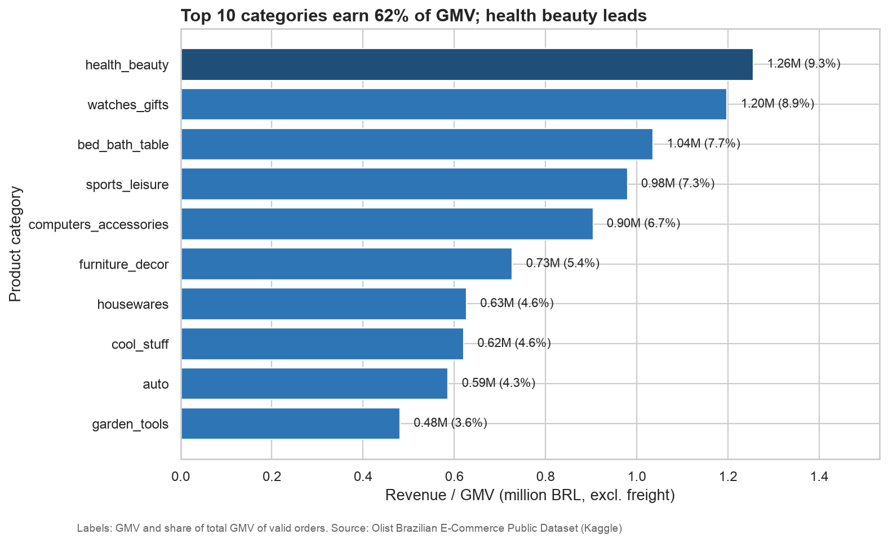

# Unit 4: Visualization Techniques for Big Data

Reader's map: this unit answers one question: *once Spark has crunched billions of rows, how do we show the result so a human can understand and act on it?* Every technique is tied to your own FA2 project (Spark on the Olist marketplace data, a stand-in for eBay). Earlier units: `01-unit1-big-data-basics.md`, `02-unit2-hadoop-and-nosql.md`, `03-unit3-apache-spark.md`. Presentation help: `05-fa1-ebay-presentation-guide.md`.

All FA2 numbers below come from `fa2/outputs/metrics.json`. The data are Olist's 2016-2018 Brazilian orders (about 100k orders), not eBay's.

---

## 1. Visualization techniques and tools for Big Data

### In one line
Data visualization turns numbers into pictures (position, length, colour, size) so the human eye can compare, spot trends and find outliers faster than it can read a table.

### Explain it like I'm new
Imagine a restaurant manager with a printout of every bill from last year (100,000 lines). Reading it is hopeless. A single line showing sales by month, and a grid showing which weekday and hour is busiest, tell the story in seconds. That is visualization.

The skill is **choosing the right chart for the question**, not choosing the prettiest chart. First decide what you want to know, then pick the chart whose visual encoding answers it. Humans are very good at comparing **positions along a common axis** and **lengths** (bar charts, line charts) and much worse at comparing **angles, areas and colour shades** (pie charts, bubbles, heatmaps). Good chart choice uses the strong skills for the most important comparison.

### Pick the chart by the question

| Question you are asking | Idea | Typical charts |
|---|---|---|
| How do things **compare**? | Compare categories | Bar chart, grouped bar, dot plot |
| How does it **change over time**? | Trend | Line chart, area chart, sparkline |
| How are values **distributed**? | Spread, skew, outliers | Histogram, box plot, violin, density |
| What are the **parts of a whole**? | Composition | Stacked bar, treemap, (pie: sparingly) |
| Are two things **related**? | Relationship | Scatter plot, bubble chart, correlation heatmap |
| **Where** is it happening? | Geography | Point map, choropleth, heatmap map, flow map |
| Who is **connected** to whom? | Network | Node-link graph, chord diagram, Sankey |

### Basic chart types and when to use each

| Chart | Best for | Watch out for |
|---|---|---|
| **Bar chart** | Comparing a measure across categories (e.g. GMV per product category). Horizontal bars when labels are long. | Start the axis at zero; sort the bars. |
| **Line chart** | A continuous trend over time, several series on one axis. | Too many lines become spaghetti; irregular time gaps. |
| **Scatter plot** | Relationship between two numeric variables, clusters and outliers. | Overplotting with big data (see challenges). |
| **Histogram** | Distribution of one numeric variable (delivery days). Bin width matters. | Too few/many bins hide or invent shape. |
| **Box plot** | Compare distributions across groups: median, quartiles, outliers. | Hides multi-peaked shapes; unfamiliar to lay audiences. |
| **Pie / donut** | Parts of a whole with 2-3 slices only. | Avoid: angle and area are hard to compare; see below. |
| **Area chart** | Trend plus magnitude; stacked area shows composition over time. | Stacked layers are hard to read except the bottom one. |
| **Bubble chart** | Scatter plus a third variable as bubble size. | Size is read poorly; bubbles overlap. |
| **Treemap** | Hierarchical composition (category > sub-category) as nested rectangles. | Precise comparison is poor; fine for "what dominates". |
| **Choropleth** | A rate/measure shaded per region (state, district). | Big empty regions look important; use rates, not raw counts. |
| **Heatmap (matrix)** | Two categorical axes with a value in each cell (weekday x hour). | Colour scale choice changes the story. |
| **Network graph** | Entities and relationships. | "Hairball" when there are too many edges. |

**Why avoid pie charts.** The eye compares angles and areas badly. Five slices of 18%, 20%, 22%, 19%, 21% look identical, while a bar chart shows the order at once. A sorted bar chart nearly always does the job better. Use a pie only for two or three very different parts ("about 60/40").

### Common confusion
*"More colours and 3D make a chart more impressive."* The opposite: 3D distorts lengths, decoration steals attention. See the design principles at the end.

### Remember
- Pick the chart from the **question** (comparison, trend, distribution, composition, relationship, geography, network).
- Bars and lines encode data most accurately; pies, bubbles and shades least.
- Always label axes with units, start bars at zero, sort categories.

---

## 2. Importance of data visualization and challenges

### In one line
Visualization helps us **see patterns, communicate results, make decisions and catch anomalies** that summary numbers hide, but Big Data makes this harder because there are too many points, they arrive too fast, and they come in too many shapes.

### Why visualization matters
1. **Pattern spotting.** Our visual system finds trends, clusters and gaps in milliseconds. In FA2, the weekday-by-hour heatmap shows the shopping rhythm instantly.
2. **Communication.** A chart with a takeaway title persuades a manager who will not read a table.
3. **Decision making.** "Late deliveries get 2.27 stars vs 4.29 for on-time" justifies investment in logistics.
4. **Anomaly detection.** Spikes and gaps jump out (Black Friday 2017 in our line chart).
5. **Exploration.** You often do not know what to ask until you see the data.

### Anscombe's quartet: the classic proof
Francis Anscombe (1973) built four small datasets (11 points each) that have **almost identical summary statistics**: mean of x about 9, mean of y about 7.5, variance, correlation about 0.82, and the same regression line `y = 3 + 0.5x`. Yet when plotted: one is a clean linear trend, one is a smooth curve, one is a perfect line spoiled by a single outlier, and one is a vertical stack with one extreme point.

```text
  Same mean, variance, correlation, regression line...
  Set I:  linear scatter     Set II: a curve
  Set III: line + 1 outlier  Set IV: vertical column + 1 leverage point
```

Lesson: **never trust summary numbers alone; always plot the data.** (The modern follow-up, the "Datasaurus Dozen", makes the same point.) In FA2, the overall correlation of delay-days versus review score is only -0.27, which hides the sharp jump in 1-star reviews once an order is more than three days late. Only the bucketed chart shows it.

### Challenges specific to Big Data

| Challenge | What goes wrong | Typical solution |
|---|---|---|
| **Volume / overplotting** | A scatter of 100M points is a solid blob; the browser freezes. | Aggregation, **binning** (hexbin, 2-D histogram), **sampling**, density/heatmap. |
| **Latency / real-time refresh** | Dashboard shows stale data, or refreshing on every event is too heavy. | Streaming pipelines, windowed aggregates, incremental updates, pre-computed rollups. |
| **Variety** | Logs, JSON, images, geo and tabular data from different sources with different formats and keys. | Unified data lake/warehouse, schema mapping, standard join keys. |
| **High dimensionality** | Humans see 2-3 dimensions; data has hundreds. | PCA/t-SNE/UMAP, parallel coordinates, small multiples. |
| **Data quality** | Nulls, duplicates, out-of-range values mislead; visual makes errors look like truth. | Profile and clean first (FA2 Phase 1 dropped 42 points outside Brazil's box). |
| **Perceptual limits / cognitive overload** | Too many colours, lines, widgets; viewer can't see what matters. | Fewer charts, a clear message, highlight one thing, interactivity (filter, drill-down). |
| **Scalability of rendering** | Drawing millions of SVG/DOM elements is slow. | Level of detail, Canvas/**WebGL/GPU** rendering, server-side rendering of tiles. |
| **Privacy and security** | Maps of individuals, small groups can re-identify people. | Aggregate, mask small counts, access control, anonymise. |

### Solutions in detail
- **Aggregation / binning.** Do not plot rows; plot summaries. Spark's `groupBy` reduces 112,650 order lines to 18 monthly points or a 7x24 grid. Rule of thumb from FA2: *Spark does the heavy lifting, pandas receives only the small final table.*
- **Sampling.** Plot a random sample (say 1%) to see the shape. Risk: rare events can disappear, so combine with aggregates.
- **Level of detail (LOD).** Show the coarse view first (states), reveal the detail on zoom (cities, then individual points). Map tiles work this way.
- **Pre-computation in Spark.** Compute the aggregates in a batch or streaming job, store them (Parquet, Hive table, Cassandra), and let the dashboard read the small result.
- **GPU / WebGL rendering.** Tools such as deck.gl and kepler.gl draw millions of points using the graphics card.

### FA2 example: the geolocation table
The Olist `geolocation` table has 1,000,163 rows. Plotting them would be pointless overplotting. FA2 first averaged latitude/longitude per zip prefix (19,010 prefixes), then mapped only 14,807 prefixes that had buyers. The interactive folium map still held 9,758 markers and produced a 7.17 MB HTML file, which shows that even aggregated maps hit rendering limits.

### Remember
- Anscombe's quartet: same statistics, totally different pictures, so plot first.
- The Big Data problem is usually **too many points**; the cure is aggregate, sample, bin, LOD, GPU.
- Clean the data before drawing it; a chart makes errors look credible.

---

## 3. Advanced visualization techniques

Four advanced techniques are covered: geospatial, network, time-series and heatmaps. Each follows the same plan: what, when, how, pitfalls, and the FA2 example.

### 3.1 Geospatial visualization

**In one line.** Plotting data on a map using latitude/longitude so that *where* becomes visible.

**Explain it like I'm new.** Every place on Earth can be given two numbers: **latitude** (north/south, -90 to 90) and **longitude** (east/west, -180 to 180). São Paulo is roughly latitude -23.5, longitude -46.6 (negative = south and west). Draw each order at its (longitude, latitude) and a map appears. A **projection** converts the round Earth onto a flat screen. Web maps use Web Mercator (EPSG:3857), which stretches areas near the poles. GPS coordinates are plain lat/lng (EPSG:4326). If you plot raw lat/lng as x/y on a plain chart, shapes look slightly stretched, so FA2's static map sets `ax.set_aspect(1 / cos(15 degrees))` to correct for Brazil's latitude.

**Types**

| Type | Shows | Use when |
|---|---|---|
| **Point / symbol map** | One dot per event or place (size/colour = measure). | Moderate counts; exact locations matter. |
| **Choropleth** | Regions shaded by a value. | You have a rate per region (late rate per state). Normalise by population/area. |
| **Heatmap / kernel density** | Smooth density surface of points. | Very many points; "hot spots" matter more than individuals. |
| **Hexbin / H3 grid** | Hexagonal cells coloured by count. | Big data: fair, regular bins; easy aggregation (Uber's H3, see case study). |
| **Flow map** | Lines or arcs between origin and destination. | Movement: shipments, trips, migration. |

**Tools:** **folium** (Python wrapper for the Leaflet JS library, interactive HTML), **GeoPandas** (geodata frames and shapefiles, static choropleths), **kepler.gl** and **deck.gl** (GPU-based, millions of points), **Tableau maps** (drag-and-drop), plus Plotly/Mapbox.

**How to build (folium)**
```python
import folium

m = folium.Map(location=[-14.5, -51.0], zoom_start=4)   # centre on Brazil
for _, r in zips.iterrows():                              # one small aggregated row per zip prefix
    folium.CircleMarker(
        location=[r.lat, r.lng],
        radius=max(2, (r.gmv ** 0.5) / 20),               # area ~ value: radius ~ sqrt(GMV)
        tooltip=f"{r.city}: BRL {r.gmv:,.0f}",
        fill=True, fill_opacity=0.6,
    ).add_to(m)
m.save("map.html")                                        # open in any browser
```

**Pitfalls**
- **Overplotting** at national scale: aggregate first.
- **Raw counts on a choropleth** just show where people live; use rates.
- Big regions look important even if few people live there.
- Wrong or missing coordinates: check bounds (FA2 removed 42 out-of-Brazil points).
- Size by radius exaggerates differences; scale radius by square root so *area* tracks the value.

**FA2 example (Q3).**
- Spark averaged 1M geolocation rows into one point per zip prefix, joined to customers, and summed orders and GMV.
- Result: SP, RJ and MG hold **63.35% of GMV** and 66.52% of orders; **SP alone is 41.88% of orders** (41,125) and the city of São Paulo is 15.57%.
- Two outputs: an interactive folium map (`fa2/figures/q3_buyer_map.html`, circles sized by sqrt of GMV, 9,758 markers, 7.17 MB) and a static scatter map using a **log colour scale** so that small towns are still visible next to São Paulo.
- 274 orders (0.28%) could not be geolocated and are reported, not hidden.



**Remember.** Lat/lng + a projection give a map; choose point, choropleth, density, hex or flow by the question; aggregate before plotting.

---

### 3.2 Network graphs

**In one line.** A graph shows **nodes** (things) and **edges** (relationships between them) so the structure of connections becomes visible.

**Explain it like I'm new.** Think of an airline route map: airports are nodes and flights are edges. A graph can be **directed** (arrows: A ships to B is not the same as B ships to A) or undirected (friendship). Edges can be **weighted** (thickness = number of orders). Useful numbers: **degree** (how many edges a node has; for directed graphs *in-degree* and *out-degree*), and **centrality** (how important a node is: degree centrality, betweenness = how often it lies on shortest paths, PageRank = linked to by important nodes).

**Layouts.** A **force-directed** layout treats edges as springs and nodes as repelling magnets, so connected nodes cluster; positions mean nothing geographically. A **geographic layout** places nodes at real coordinates (use it when location is meaningful). Other layouts: circular, hierarchical (trees).

**When to use:** supply chains, social networks, fraud rings, dependencies, shipment flows, recommendation links.

**Tools:** **networkx** (build and analyse graphs in Python), **Gephi** (desktop GUI for large graphs, nice layouts), **pyvis** (interactive HTML graphs from Python), **D3.js** (custom web visualization), also Neo4j Bloom for graph databases.

**How to build (networkx)**
```python
import networkx as nx
import matplotlib.pyplot as plt

G = nx.DiGraph()                                   # directed graph
for r in flows.itertuples():                       # one row per (seller_state, customer_state)
    G.add_edge(r.seller_state, r.customer_state, weight=r.orders)

pos = {s: (lng[s], lat[s]) for s in G.nodes}       # geographic layout: node at state centroid
widths = [G[u][v]["weight"] / 500 for u, v in G.edges]   # edge thickness ~ orders
nx.draw_networkx_nodes(G, pos, node_size=300)
nx.draw_networkx_edges(G, pos, width=widths, alpha=0.4)
nx.draw_networkx_labels(G, pos)
plt.show()
print(nx.out_degree_centrality(G))                 # who ships to the most states
```

**Pitfalls**
- **Hairball:** hundreds of edges become unreadable. Filter by weight, aggregate nodes (states, not sellers), or use an adjacency matrix.
- Force-directed layouts change on every run and distances may mislead.
- Direction and weight must be visible (arrows, thickness) or the chart is ambiguous.

**FA2 example (Q5).**
- Nodes = Brazilian states, placed at **state centroids** (so the graph reads like a map); an edge = seller state -> buyer state, thickness = number of orders.
- **Edge threshold of 500 orders**: out of all inter-state pairs only **24 edges** are drawn, otherwise the picture is a hairball. Those 24 edges still hold SP flows worth 73.13% of drawn edge orders.
- Findings: **64.18% of orders are inter-state** (63,359 of 98,715 flows) and only 35.82% stay in-state. SP sellers originate **70.76%** of all flows and ship to 27 states (SP is the hub). Average freight BRL 23.69 inter-state vs BRL 13.45 intra-state; SP to BA takes 19.68 days vs 7.86 for SP to SP.
- Degree idea in action: SP's out-degree is 27 buyer states; AC's only 1.



**Remember.** Nodes + edges (+ direction, weight); degree and centrality measure importance; pick geographic vs force-directed layout; filter edges to avoid the hairball.

---

### 3.3 Time-series visualization

**In one line.** Plotting a measure against time (usually a **line chart**) to reveal **trend, seasonality and anomalies**.

**Explain it like I'm new.** A time series is a list of values recorded in time order (orders per month). Three things matter: **trend** (the long-run direction), **seasonality** (patterns that repeat: weekly, yearly, daily) and **anomalies** (points that break the pattern: a promotion, an outage). Time always goes on the x-axis, left to right, and points are joined by a line because time is continuous.

**Techniques**
- **Line chart** for one or a few series; **area chart** to show magnitude.
- **Rolling (moving) average** smooths noise: average of the last 7 days or 3 months.
- **Multiple series** on one chart (orders and GMV) - use a dual panel or normalise if the scales differ.
- **Small multiples:** one small chart per category, same axes, for comparison without clutter.
- **Annotations of events** (promotion, outage, holiday) turn a squiggle into a story.
- Bigger data: aggregate to a coarser time grain (day -> week -> month), and downsample for rendering.

**Tools:** matplotlib/seaborn/plotly for code; Grafana, Kibana and Tableau for dashboards; Prometheus/InfluxDB as time-series stores.

**How to build**
```python
import matplotlib.pyplot as plt

fig, ax = plt.subplots(figsize=(11, 4))
ax.plot(monthly.index, monthly.orders, marker="o", label="Orders")
ax.plot(monthly.index, monthly.orders.rolling(3).mean(), label="3-month average")  # smooth the noise
peak = monthly.orders.idxmax()
ax.annotate("Black Friday?", xy=(peak, monthly.orders.max()),
            xytext=(10, 10), textcoords="offset points",
            arrowprops=dict(arrowstyle="->"))                                   # annotate the event
ax.set_ylabel("Orders per month"); ax.legend()
```

**Pitfalls**
- Truncated or dual y-axes that mislead.
- Incomplete first/last months (partial months look like crashes).
- Seeing a cause (Black Friday) where there is only a coincidence. Say "plausible", as FA2 does.
- Mixing time zones or irregular intervals.

**FA2 example (Q1).**
- Spark joined orders and items, grouped by month, and used a `lag()` window function for month-over-month (MoM) growth.
- Orders rose from **787 (Jan 2017) to 6,421 (Aug 2018), about 8.16x**. **Peak: November 2017 with 7,421 orders** (BRL 1,003,862 GMV), up **63.2%** on October, then **-24.3%** in December. Single peak day: **2017-11-24 with 1,166 orders**. Jan-Aug 2018 against Jan-Aug 2017: orders +137.3%.
- Design: two stacked panels (orders and GMV, sharing the x-axis) with the peak circled and annotated; **thin months** (Sep 2016, Dec 2016, Sep 2018, Oct 2018 had 1 to 16 orders) were excluded from the trend so partial data does not look like a crash.



**Remember.** Trend, seasonality, anomaly; smooth with rolling averages; annotate events; exclude partial periods; do not claim causation.

---

### 3.4 Heatmaps

**In one line.** A heatmap uses **colour intensity** to show the size of a value; there are two quite different kinds: matrix heatmaps and geographic heatmaps.

**Explain it like I'm new.** A **matrix heatmap** is a grid: rows are one category, columns another, each cell coloured by a value (orders at *Tuesday, 14:00*). Great for spotting hot and cold zones. A **geographic heatmap** (kernel density) smooths many points on a map into a glowing surface; it is a map technique (section 3.1), unrelated to the grid kind.

**Colour scales**
- **Sequential** (light to dark of one hue, e.g. Blues): for values from low to high. Use for counts.
- **Diverging** (two hues meeting at a neutral midpoint, e.g. blue-white-red): for values with a meaningful centre (correlation -1 to +1, growth above/below zero).
- **Avoid rainbow ("jet")**: it adds false boundaries and fails for colour-blind users. Prefer perceptually uniform palettes (viridis, Blues).
- **Log scale** when a few cells dwarf the rest.

**Correlation heatmap:** compute `df.corr()` and plot it with a diverging palette to see which numeric variables move together. A **clustermap** also re-orders rows and columns so similar ones sit together.

**How to build**
```python
import seaborn as sns
# m: DataFrame, rows = weekday, columns = hour 0-23, values = order counts
ax = sns.heatmap(m, cmap="Blues", linewidths=0.6, linecolor="white",
                 cbar_kws={"label": "Orders"})
ax.set_xlabel("Hour of day (00-23)"); ax.set_ylabel("Weekday")

# correlation heatmap
sns.heatmap(df.corr(), cmap="RdBu_r", center=0, vmin=-1, vmax=1, annot=True)
```

**Pitfalls**
- Colour is a weak channel: exact values are hard to read, so annotate key cells or add a colour bar.
- Order matters: put weekdays Mon-Sun, hours 0-23 (not alphabetical).
- Different groups of very different size need normalisation (percent) or the big one always wins.

**FA2 example (Q2).**
- Spark extracted weekday and hour, grouped and **pivoted** into a 7 x 24 grid (168 cells) - 98,199 valid orders turned into a picture a manager can read in seconds.
- Findings: the **single hottest cell is Tuesday 14:00 with 1,106 orders** (circled in red); **Monday is busiest (16.3%)** and **Saturday quietest (11.0%)**; **14:00-17:00 holds 19.8%** of orders; 00:00-06:00 only 4.8%; weekdays 77.0% vs weekend 23.0%.
- Sequential **Blues** palette, white gridlines between cells, a takeaway title, a red rectangle plus annotation around the peak.



**Remember.** Matrix heatmap = two categories + colour; sequential for counts, diverging for centred values; annotate the peak.

---

### Compare: choosing among the four advanced techniques

| Technique | Question | FA2 chart | Spark reduction |
|---|---|---|---|
| Time series | How did it change? | Q1 line | 112,650 rows -> 18 months |
| Heatmap | When is it busiest? | Q2 grid | 98,199 orders -> 7 x 24 cells |
| Geospatial | Where is it? | Q3 map | 1M geo rows -> 14,807 zip points |
| Network | What connects to what? | Q5 graph | 98,715 flows -> 24 drawn edges |

---

## 4. Visualization for streaming and high-dimensional data

### 4.1 Streaming data

**In one line.** Streaming visualization shows data **as it arrives** (seconds-old), using continuously updated dashboards fed by a stream processor.

**Explain it like I'm new.** Batch charts are a photograph: computed once on yesterday's data. Streaming charts are a live video: a stream of events (clicks, GPS pings, sensor readings) is summarised continuously and the chart updates itself. Because the stream never ends, you cannot "wait for all the data"; you summarise **windows** of time.

**Windows**
- **Tumbling window:** fixed, non-overlapping blocks (every minute: 12:00-12:01, 12:01-12:02...). Each event falls in exactly one.
- **Sliding window:** fixed length, moves by a smaller step (last 5 minutes, refreshed every 1 minute). Events fall in several windows; smoother.
- **Session window:** closes after a gap of inactivity.

**Typical pipeline**
```text
 events (apps, sensors, logs)
        |
        v
   Kafka topic  --->  Spark Structured Streaming / Flink
                          (windowed aggregation, watermark for late data)
                                   |
                                   v
                    serving store (Elasticsearch / Cassandra / InfluxDB)
                                   |
                                   v
                     live dashboard (Grafana / Kibana / Superset)
                                   |
                                   v
                              alerts (email, Slack, pager)
```

**Design points:** show the **latest value plus a short trend** (big number + sparkline), refresh at a rate people can follow, use **incremental updates** (append new points instead of redrawing everything), fix the time window explicitly, add **alerting thresholds** (colour turns red, notification is sent), and show "last updated" so users know the data is fresh. Handle **late and out-of-order data** with watermarks.

**Tools:** **Grafana** (time-series dashboards, many data sources), **Kibana** (Elasticsearch logs and metrics), **Apache Superset** (open-source BI, SQL-based), Spark Structured Streaming and Kafka on the processing side.

**FA2 link.** `insights.md` notes the late-delivery logic (promised date versus now) could run in Spark Structured Streaming to raise real-time delay alerts; Q1's 7,421-order November spike is exactly the kind of surge a live dashboard would catch as it happens. FA2 itself is batch, not streaming.

### 4.2 High-dimensional data

**In one line.** When data has many columns (dimensions), we either **project it down to 2-D** or use special charts that show many dimensions at once.

**Explain it like I'm new.** A scatter plot has 2 axes; a 3-D plot has 3. A customer table may have 50 features. We cannot draw 50 axes, so we squash it.

| Technique | Idea | Good for | Caution |
|---|---|---|---|
| **PCA** (principal component analysis) | Linear projection onto the directions of greatest variance. | Fast, deterministic overview; first 2 components. | Misses non-linear structure; axes are abstract. |
| **t-SNE** | Non-linear; keeps close neighbours close. | Finding clusters (images, text embeddings). | Slow on big data; distances between clusters and cluster sizes are not meaningful; results vary by perplexity. |
| **UMAP** | Non-linear like t-SNE but faster, better global structure. | Large datasets, embeddings. | Still a projection; parameters change the picture. |
| **Parallel coordinates** | One vertical axis per dimension; each record is a line crossing all. | Comparing many numeric features, finding groups of similar lines. | Cluttered for large data; axis order matters. |
| **Scatter-plot matrix (SPLOM)** | Grid of all pairwise scatter plots. | Quick look at relationships among ~5-10 variables. | Grows as N squared; overplotting. |
| **Heatmap / clustermap** | Rows x features coloured by value, rows and columns re-ordered by similarity. | Many items and features, gene-expression style. | Needs scaled data. |
| **Small multiples** | Same simple chart repeated per category. | Compare groups without 3-D clutter. | Needs shared axes. |

```python
from sklearn.decomposition import PCA
import seaborn as sns

X2 = PCA(n_components=2).fit_transform(X_scaled)        # 50 features -> 2
sns.scatterplot(x=X2[:, 0], y=X2[:, 1], hue=labels)

sns.pairplot(df[["price", "freight", "delivery_days", "review"]])   # SPLOM
sns.clustermap(df_scaled, cmap="vlag")                              # re-ordered heatmap
```

In Big Data, run the reduction **in Spark** (MLlib has PCA) or on a sample, then plot the 2-D result.

### Remember
- Streaming = windows (tumbling, sliding) + Kafka + stream processor + live dashboard + alerts.
- High-dimensional = reduce (PCA, t-SNE, UMAP) or show all (parallel coordinates, SPLOM, clustermap, small multiples).
- t-SNE/UMAP pictures show neighbourhood structure, not exact distances.

---

## 5. Big Data visualization with Python, Tableau, Power BI and other tools

### In one line
Pick **code libraries** (flexible, reproducible) when you need custom analysis, and **GUI tools** (fast, shareable dashboards) when business users need to explore; at Big Data scale, either one should read pre-aggregated data, not raw billions of rows.

### Python libraries

| Library | Best for | Minimal snippet |
|---|---|---|
| **matplotlib** | Base plotting, full control, static publication-quality charts. | `plt.plot(x, y); plt.show()` |
| **seaborn** | Statistical charts (heatmaps, box plots, distributions) on top of matplotlib. | `sns.heatmap(m, cmap="Blues")` |
| **plotly** | Interactive web charts (hover, zoom), maps, dashboards via Dash. | `px.line(df, x="month", y="orders")` |
| **folium** | Interactive Leaflet maps. | `folium.Map(location=[-14.5,-51], zoom_start=4)` |
| **networkx** | Build/analyse graphs; basic drawing. | `G = nx.DiGraph(); G.add_edge("SP","RJ")` |
| **bokeh** | Interactive browser plots, streaming and big data via server. | `p = figure(); p.line(x, y); show(p)` |
| **altair** | Declarative grammar of graphics (Vega-Lite), concise charts. | `alt.Chart(df).mark_bar().encode(x="cat", y="gmv")` |

Related big-data Python tools: **Datashader** (renders billions of points by rasterising on a grid), **HoloViews/hvPlot**, **Dask** for larger-than-memory frames.

**Pattern for Spark + Python** (the one used in FA2):
```python
# 1. Heavy work in Spark
monthly = (orders.groupBy("purchase_month")
                 .agg(F.countDistinct("order_id").alias("orders")))
# 2. Only the small aggregated table goes to pandas
pdf = monthly.orderBy("purchase_month").toPandas()      # 18 rows, not 100k
# 3. Plot
pdf.plot(x="purchase_month", y="orders")
```
`toPandas()` is an action that collects to the driver; calling it on a huge DataFrame crashes the driver, so aggregate first.

### Tableau and Power BI

**Tableau** (Salesforce) and **Microsoft Power BI** are GUI business-intelligence tools: you drag fields onto a canvas to build charts, combine them into **dashboards** with filters and drill-downs, and publish them (Tableau Server/Cloud, Power BI Service).

**Connecting to big data sources**
- Connectors exist for Spark SQL, Hive, Databricks, Snowflake, BigQuery, Redshift, SQL databases, files, and more (via ODBC/JDBC or native connectors).
- **Live connection:** every click sends a query to the source. Always fresh, but slow if the source is slow, and it loads the cluster. (Power BI calls it DirectQuery.)
- **Extract (import) mode:** data is copied into the tool's fast in-memory engine (Tableau Hyper extract; Power BI Import). Very fast and works offline, but data is only as fresh as the last refresh and size is limited by memory.
- Practical rule: aggregate in Spark/Hive, connect the BI tool to that aggregate (or an extract), and use live mode only where freshness is essential.

### Other tools
- **Apache Superset:** open-source BI, SQL-based, connects to Spark SQL/Presto/Druid.
- **Grafana:** time-series and operational dashboards, alerts.
- **Kibana:** dashboards over Elasticsearch (logs, search, metrics).
- **Qlik (Sense):** associative in-memory BI.
- **D3.js:** JavaScript library for fully custom web visualizations (steep learning curve).
- **deck.gl / kepler.gl:** GPU-accelerated geospatial.

### Comparison

| Tool | Type | Strengths | Big-data scale | Cost |
|---|---|---|---|---|
| matplotlib/seaborn | Code | Control, reproducible, free | Small result tables (aggregate first) | Free |
| plotly / bokeh / altair | Code | Interactive, web-ready | Moderate; bokeh/Datashader scale further | Free (Dash Enterprise paid) |
| Tableau | GUI | Best-in-class exploration, polished dashboards | Large via live connectors or extracts | Paid (per user) |
| Power BI | GUI | Microsoft ecosystem, low cost | Large via DirectQuery or Import (size limits apply) | Free desktop; paid service |
| Superset | GUI (open source) | SQL-first, free, many sources | Scales with the backing engine | Free (self-hosted) |
| Grafana | GUI | Real-time metrics, alerting | Good for time-series stores | Free OSS; paid cloud |
| Kibana | GUI | Logs and search | Scales with Elasticsearch | Free basic; paid tiers |
| Qlik | GUI | Associative exploration | In-memory; scales with licensing | Paid |
| D3.js | Code (JS) | Total custom control | Browser-limited; pre-aggregate | Free |

(Costs and limits change; check current vendor pricing.)

### Common confusion
*"I'll just connect Tableau to the raw table and it will handle billions of rows."* The tool only sends queries or loads extracts; if the source is slow or the extract is too large, the dashboard is slow. Pre-aggregate.

### Remember
- Code tools = flexible and reproducible; GUI tools = fast dashboards for business users.
- Live connection = fresh but slow; extract = fast but stale.
- Rule for every tool: **aggregate first, visualise the summary.**

---

## 6. Case study: Uber - real-time dynamic pricing visualization

Note on sources: this section is based on what Uber has publicly described in engineering blogs and open-source releases. Uber's internal systems change and are not fully public, so treat the architecture as an illustrative, simplified picture. No statistics are claimed here.

### In one line
Uber turns live rider requests and driver locations into per-area supply and demand numbers and shows them on hexagon maps and dashboards, so prices and driver positioning can respond within minutes.

### The problem
A ride-hailing marketplace must match **demand** (riders requesting) with **supply** (available drivers) in every part of a city, all the time. When demand in an area outstrips supply (after a concert, in the rain), riders wait long and drivers are too far away. Uber's response is **dynamic ("surge") pricing**: a **multiplier** on the base fare for that area, which has two goals: draw more drivers toward the area and moderate demand. Operators and drivers need to **see** where and when this imbalance happens, which is a visualization problem as much as a pricing one.

### Data flow (simplified, illustrative)
```text
 Rider app: ride requests ----\
                               \
 Driver app: GPS pings,         >-->  Kafka (message queue / event log)
 availability status ---------/              |
                                             v
                         Stream processing (Uber has described pipelines built
                         on technologies such as Apache Flink, Samza and Spark)
                                             |
                  map each event to a hexagon cell (H3 index)
                                             |
                                             v
                  per-area, per-time-window:  demand   supply   ratio
                                             |
                     +-----------------------+----------------------+
                     v                                              v
            Pricing / surge model                        Visual monitoring
         (multiplier per area, sent to                (heatmaps of demand vs supply,
          rider and driver apps)                       ops dashboards, alerts)
```
Compare with the generic streaming pipeline in section 4.1: it is the same pattern (events, Kafka, windowed stream processing, serving, dashboard).

### The geospatial grid: H3
In 2018 Uber open-sourced **H3**, a **hexagonal hierarchical geospatial index**. It divides the Earth into hexagonal cells at several resolutions (coarse cells for regions, fine cells for city blocks); every cell has an ID, and a latitude/longitude point maps to the cell that contains it. Zooming in or out means moving between parent and child resolutions, so aggregation at any level is cheap, which is what Big Data needs.

**Why hexagons?**
- A hexagon's neighbours are all **the same distance** from its centre (squares have close edge neighbours and farther diagonal ones), which suits movement and distance-based analysis.
- Hexagons approximate circles, so there is **less edge distortion** than with squares, and smooth, regular-looking heatmaps.
- Every neighbour shares an edge, which makes "nearby cells" and smoothing simple.
- Caveat: a hexagon grid cannot tile a sphere perfectly; H3 has a few special cells (pentagons) because of this.

### What is visualized
- **Heatmaps of demand vs supply per hexagon over time** (requests versus available drivers, or their ratio, animated across the hours).
- **Surge maps in the driver app:** coloured areas showing where fares are boosted so drivers can reposition.
- **Internal operations dashboards** for city teams to monitor marketplace health, spot anomalies and respond to events.
- Uber also open-sourced the visualization tools **deck.gl** (a WebGL framework for large-scale layers) and **kepler.gl** (a no-code geospatial analysis tool built on deck.gl), which handle millions of points by using the GPU. These connect directly to the challenges in section 2 (volume, rendering scalability).

### Insights and actions
- Find under-served hexagons (high demand, low supply) and send incentives or surge to pull drivers in.
- Detect sudden spikes (events, weather, outages) as anomalies on the time-series.
- Plan fleet and incentives from historical patterns such as weekday-by-hour rhythms (the same idea as our FA2 Q2 heatmap).
- Compare areas fairly because hexagons have uniform size.

### Challenges
- **Latency:** prices and maps must reflect the last few minutes; slow pipelines mean wrong prices.
- **Scale:** many events per second from many cities; requires partitioned stream processing and pre-aggregation per cell.
- **Noise and flicker:** tiny cells with few events give jumpy ratios, so smoothing and coarser resolutions are used.
- **Fairness and public perception:** high multipliers in emergencies or in poorer areas draw criticism; transparency and caps are part of the design.
- **Privacy:** location data is sensitive, so aggregate per cell instead of showing individuals.

### Link to FA2
Our FA2 charts answer the *historical* version of Uber's question: Q2 shows *when* demand peaks (Tuesday 14:00), Q3 shows *where* (SP 41.88% of orders), and Q1 shows surges (Nov 2017, +63.2%). Uber does the same continuously, on a hexagon grid, with streaming instead of batch.

### Remember
- Problem: balance supply and demand per area in real time; solution lever: surge multiplier.
- Pipeline: app events -> Kafka -> stream processing -> per-hexagon supply/demand -> pricing + visual monitoring.
- H3: hexagonal hierarchical index (open-sourced 2018); deck.gl and kepler.gl: GPU visualization tools from Uber.

---

## 7. How our FA2 project did visualization

### The seven charts
FA2 produced **7 charts**, of which **4 are the "advanced" ones** required by the rubric (Q1, Q2, Q3, Q5).

| # | Question | File | Type | Advanced? |
|---|---|---|---|---|
| 1 | Q1 growth | `q1_monthly_trend.png` | Time-series line, 2 panels | Yes |
| 2 | Q2 when | `q2_weekday_hour_heatmap.png` | Matrix heatmap | Yes |
| 3 | Q3 where | `q3_buyer_map.png` (+ interactive `q3_buyer_map.html`) | Geospatial scatter map + folium map | Yes |
| 4 | Q4 delay vs review | `q4_late_vs_score.png` | Bar chart | No |
| 5 | Q4 late by state | `q4_late_rate_by_state.png` | Bar chart | No |
| 6 | Q5 flows | `q5_state_flow_network.png` | Network graph | Yes |
| 7 | Q6 categories | `q6_top_categories.png` | Horizontal bar | No |

The folium HTML map is a bonus interactive version of chart 3. Scripts: `q1_time_series.py`, `q2_heatmap.py`, `q3_geospatial.py`, `q4_delivery_reviews.py`, `q5_network.py`, `q6_categories.py` in `fa2/analysis/`.




### Design choices (and why)
- **Takeaway titles.** Each title states the finding, for example "Buyers cluster on the south-east coast: SP alone is 42% of orders", instead of "Orders by state". The reader gets the message even without the body text.
- **Annotations.** The peak month in Q1 and the peak cell in Q2 are circled and labelled; the top cities on the map are labelled.
- **Log colour scale (Q3).** Orders per zip prefix range from 1 to thousands (São Paulo). A linear scale would paint everything but São Paulo pale; `LogNorm` keeps small towns visible.
- **Nodes at state centroids (Q5).** Placing nodes at real positions makes the network read like a map and keeps meaning in the layout, unlike a force-directed layout.
- **Edge threshold of 500 orders (Q5).** Only 24 edges are drawn so that the graph is not a hairball; the caption states the threshold, so nothing is hidden dishonestly.
- **Excluding thin months (Q1).** Four partial months are left out of the trend, and the exclusion is stated.
- **Aggregate in Spark, plot in pandas.** The Big Data challenge (volume) is solved before plotting.
- **Folium interactive map.** Circle size ~ sqrt(GMV), tooltips, zoom: lets the viewer explore; costs 7.17 MB for 9,758 markers.
- **Consistent look.** White background, a shared palette from `common.py`, labelled axes with units (BRL), a source caption on every chart, and the not-geolocated count reported.
- **Honesty.** Findings are called correlations, not causes (Q4: overall correlation of delay and score is -0.27).

### Design principles (short list)
1. **Tufte's data-ink ratio:** maximise the share of ink that shows data; remove chart junk (heavy gridlines, borders, shadows, decoration).
2. **Title = takeaway:** say what the reader should conclude.
3. **Colour-blind-safe palettes:** about 8% of men have some colour-vision deficiency; use viridis/Blues/ColorBrewer safe palettes and do not rely on red-vs-green alone.
4. **Label axes and units** (BRL, orders, hours) and add a source.
5. **Avoid 3D and pie charts;** use sorted bars and lines.
6. **Start bars at zero;** do not truncate axes to exaggerate.
7. **Limit colours and elements;** emphasise one thing (grey everything else, one highlight colour).
8. **Show uncertainty and caveats** (partial months, missing data, correlation vs causation).

### Remember
- 7 charts, 4 advanced (time series, heatmap, geospatial, network).
- Choices to quote: takeaway titles, annotations, log colour scale, state-centroid nodes, 500-order edge threshold, folium map.

---

## Quick revision

1. Visualization turns data into pictures; pick the chart by the **question**: comparison (bar), trend (line), distribution (histogram/box), composition (stacked bar/treemap), relationship (scatter), geography (maps), network (node-link).
2. Avoid pie charts (angles are hard to compare) and 3D; use sorted bars.
3. Importance: pattern spotting, communication, decisions, anomaly detection. **Anscombe's quartet**: identical statistics, different plots; always plot.
4. Big Data challenges: volume/overplotting, latency, variety, high dimensionality, data quality, cognitive overload, rendering scalability, privacy.
5. Fixes: aggregation/binning, sampling, level of detail, pre-computation in Spark, GPU/WebGL.
6. **Geospatial:** lat/lng + projection; point, choropleth, heatmap, hexbin/H3, flow; tools folium, GeoPandas, kepler.gl, deck.gl. FA2: SP 41.88% of orders; top 3 states 63.35% of GMV.
7. **Network:** nodes, edges, direction, weight, degree, centrality; force-directed vs geographic layout; networkx, Gephi, pyvis, D3. FA2: 64.18% inter-state; SP = 70.76% of flows; 24 edges (threshold 500).
8. **Time series:** trend, seasonality, anomaly; rolling average, small multiples, annotate events. FA2: Nov 2017 peak 7,421 orders (+63.2%); 8.16x growth Jan 2017 to Aug 2018.
9. **Heatmap:** colour = value in a grid; sequential vs diverging; correlation heatmap. FA2: Tuesday 14:00 = 1,106 orders; 14:00-17:00 = 19.8%.
10. **Streaming:** tumbling/sliding windows, Kafka -> stream processor -> dashboard (Grafana/Kibana/Superset), incremental updates, alerts.
11. **High-dimensional:** PCA (linear), t-SNE/UMAP (non-linear), parallel coordinates, SPLOM, clustermap, small multiples.
12. **Python libs:** matplotlib (base), seaborn (stats), plotly/bokeh (interactive), altair (declarative), folium (maps), networkx (graphs). **Tableau/Power BI:** GUI dashboards; live vs extract.
13. **Uber case:** surge multiplier balances demand and supply; pipeline app -> Kafka -> stream processing -> per-hexagon metrics -> pricing + dashboards; H3 hexagonal index (2018); deck.gl and kepler.gl.
14. FA2: 7 charts, 4 advanced; takeaway titles, log colour scale, state-centroid nodes, edge threshold 500, folium map.
15. Design: data-ink, takeaway titles, colour-blind-safe palettes, labelled axes with units, no 3D/pie.

---

## Viva questions

**1. What is data visualization and why do we need it for Big Data?**
It is representing data graphically so patterns, trends and outliers are visible. With Big Data, tables are unreadable, so aggregated visuals are the only way a human can quickly grasp results and make decisions.

**2. How do you choose the right chart?**
Start from the question: comparison uses bars, trend uses lines, distribution uses histograms or box plots, relationship uses scatter plots, composition uses stacked bars or treemaps, geography uses maps, connections use network graphs. In FA2 each of Q1-Q6 was matched this way.

**3. Why are pie charts discouraged?**
Humans compare angles and areas poorly, so similar slices look equal; a sorted bar chart shows the order instantly. A pie is acceptable only for two or three very different parts.

**4. What does Anscombe's quartet show?**
Four datasets with nearly identical mean, variance, correlation (about 0.82) and regression line but very different shapes when plotted: a linear one, a curve, one with an outlier, and one with a single leverage point. It proves summary statistics can mislead and you should always plot the data.

**5. List challenges of visualizing Big Data.**
Volume/overplotting, real-time latency, variety of sources, high dimensionality, data quality, perceptual limits and cognitive overload, rendering scalability, and privacy.

**6. How do you handle overplotting with millions of points?**
Aggregate or bin (hexbin, 2-D histogram, heatmap), sample, use transparency, or use density rendering such as Datashader or GPU tools like deck.gl. In FA2 we averaged 1M geolocation rows to 19,010 zip prefixes first.

**7. What is level of detail (LOD)?**
Showing coarse summaries when zoomed out and revealing finer data as the user zooms or drills down, as maps do from country to state to city. It keeps rendering fast and the view readable.

**8. Explain geospatial visualization and its types.**
Plotting data using latitude/longitude on a map. Types: point maps, choropleths (regions shaded by value), heatmaps/kernel density, hexbin/H3 grids and flow maps. Use choropleths for rates, not raw counts.

**9. What is a projection and why does it matter?**
A projection maps the curved Earth onto a flat screen; all projections distort something (Web Mercator inflates areas near poles). It matters for accurate shapes and distances; our static map corrected the aspect ratio for Brazil's latitude.

**10. Explain network graph terms: node, edge, degree, centrality.**
Nodes are entities, edges are relationships (possibly directed and weighted). Degree is the number of edges at a node; centrality measures importance (degree, betweenness, PageRank). In FA2, SP has out-degree 27 states and 70.76% of flows, so it is the hub.

**11. Force-directed vs geographic layout?**
Force-directed layouts place connected nodes close using a spring simulation, revealing clusters but with arbitrary positions. Geographic layouts use real coordinates, which is better when location is meaningful, as with FA2's state-centroid placement.

**12. Why did FA2 use an edge threshold of 500 orders?**
To avoid a hairball. Only 24 inter-state flows with at least 500 orders were drawn; the caption states this so the reader knows smaller flows are omitted.

**13. What do you look for in a time series and how do you present it?**
Trend, seasonality and anomalies. Use a line chart, smooth with rolling averages, annotate events and exclude partial periods. FA2's Q1 shows 8.16x growth and the Nov 2017 peak (7,421 orders, +63.2%), which is plausibly Black Friday but not proven.

**14. Sequential vs diverging colour scales; when each?**
Sequential (light to dark) for values from low to high, such as order counts (FA2 used Blues). Diverging (two hues around a neutral midpoint) for values with a meaningful centre such as correlations or growth above/below zero. Avoid rainbow palettes.

**15. What did the FA2 heatmap show?**
A 7 x 24 weekday-by-hour grid: peak slot Tuesday 14:00 (1,106 orders), Monday busiest (16.3%), Saturday quietest (11.0%), 14:00-17:00 holds 19.8% of orders, night 00:00-06:00 only 4.8%. Use: time campaigns before peaks, run batch jobs overnight.

**16. Explain tumbling and sliding windows.**
Tumbling windows are fixed, non-overlapping intervals (each event belongs to one). Sliding windows have a fixed length but move in smaller steps, so windows overlap and give smoother, more frequent updates. Both are used to aggregate an endless stream for live dashboards.

**17. How would you visualize a dataset with 50 features?**
Reduce to 2-D with PCA (fast, linear) or t-SNE/UMAP (non-linear clusters), or show many dimensions with parallel coordinates, a scatter-plot matrix, a clustermap or small multiples. Do the reduction in Spark or on a sample; remember t-SNE distances between clusters are not meaningful.

**18. Live connection vs extract in Tableau/Power BI?**
A live connection (DirectQuery) queries the source on every interaction: always fresh but dependent on source speed. An extract/import copies data into the tool's in-memory engine: fast but only as fresh as the last refresh. For big data, aggregate in Spark/Hive first and connect to that.

**19. Describe the Uber dynamic pricing visualization case.**
Rider requests and driver GPS pings flow into Kafka, are processed by a stream-processing layer (Uber has described Flink, Samza and Spark-based systems), mapped to H3 hexagon cells and aggregated into per-area demand and supply. This drives surge multipliers and visual monitoring: demand-vs-supply heatmaps, surge maps in the driver app and ops dashboards. Challenges: latency, scale, noisy small cells, fairness and privacy.

**20. Why does Uber use hexagons (H3) instead of squares?**
All neighbours of a hexagon are equidistant from its centre and share an edge, so distance-based analysis and smoothing are cleaner; hexagons approximate circles with less distortion; the hierarchy makes aggregation at several resolutions cheap. H3 was open-sourced by Uber in 2018. deck.gl and kepler.gl are Uber's open-source tools to render such data on the GPU.
